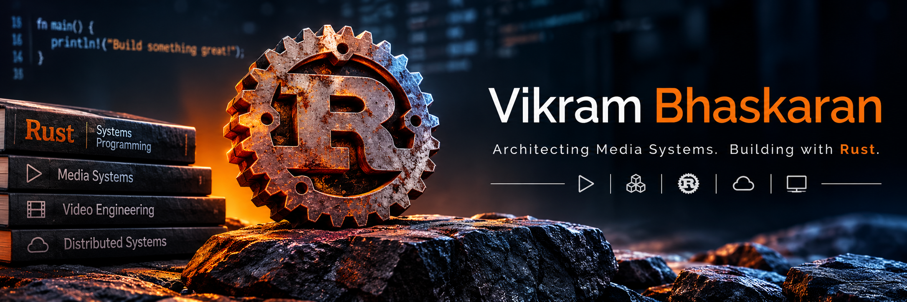

  

  Sydney · <a href="https://www.nrl.com">NRL</a> · <a href="https://au.linkedin.com/in/vbasky">LinkedIn</a> · <a href="https://x.com/vikrambhaskar">X</a>

Each row is a tool I replaced. The star counts are live, and the rows reorder themselves.

## Featured Projects

### Media

| Before | After | Stars |
| --- | --- | --- |
| ffmpeg's audio chain | [cathar](https://github.com/vbasky/cathar) restores a recording, levels it to LUFS, and writes the WAV. No ffmpeg. [Notes](https://medium.com/@vbasky/catharsis-for-noisy-audio-a-pure-rust-restoration-toolkit-with-no-ffmpeg-and-no-black-boxes-a6c5c38e4c14) |  |
| MediaInfoLib | [revelo](https://github.com/vbasky/revelo) reads 177 formats, byte for byte with the C++ tool. [Notes](https://medium.com/@vbasky/porting-200-000-lines-of-c-to-rust-building-a-byte-identical-mediainfo-replacement-8e9b587d469a) |  |
| Shaka Packager | [sheathe](https://github.com/vbasky/sheathe) packages CMAF, DASH, and HLS, including the CENC matrix. [Notes](https://medium.com/@vbasky/packaging-the-worlds-video-in-pure-rust-ff1f6b884fec) |  |
| a fixed bitrate ladder | [viser](https://github.com/vbasky/viser) builds per-shot ladders for H.264, HEVC, and AV1. [Notes](https://medium.com/@vbasky/measure-dont-guess-building-viser-a-content-adaptive-video-encoding-optimizer-in-rust-7675edd6943a) |  |
| ranking images by hand | [eligo](https://github.com/vbasky/eligo) generates a batch, scores it, and keeps the best. |  |

### Data

| Before | After | Stars |
| --- | --- | --- |
| SurrealQL by hand | [somnia](https://github.com/vbasky/somnia) checks the queries at compile time. [Notes](https://medium.com/@vbasky/somnia-a-type-safe-orm-for-surrealdb-that-feels-like-diesel-7341d49bd5c4) |  |
| an ontology in a text file | [ontaria](https://github.com/vbasky/ontaria) looks up, validates, diffs, and generates. It also reads EBUCore. |  |

### Desktop

| Before | After | Stars |
| --- | --- | --- |
| Dark+ and Light+, somewhere else | [sublime-vscode-plus](https://github.com/vbasky/sublime-vscode-plus) is those colors, in Sublime Text. |  |
| Jupyter | [patina](https://github.com/vbasky/patina) runs Rust, Python, and JavaScript kernels without it. |  |
| a menu you configure | [hatch](https://github.com/vbasky/hatch) writes the widget when you ask, then hot-reloads it. |  |

---

## At work

Since 2021 I have owned media and digital infrastructure for the [NRL](https://www.nrl.com) and its 16 clubs: live ingest, encoding, the library, the apps, and [NRL Studio](https://studio.nrl.com). 130,000 VOD assets moved onto Shaka Packager.

Before that: video at Kintell, connected-TV apps at Stan, SBS On Demand on Telstra TV, and the Foxtel player at Switch Media.
